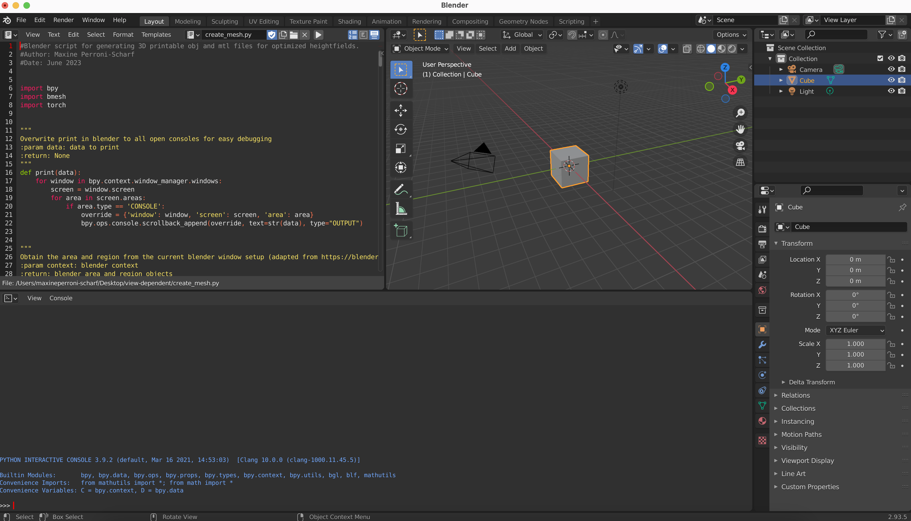

# Constructing Printable Surfaces with View-Dependent Appearance
### [Project Page](https://maxineaps.github.io/view-dependent-project-site/) | [Paper](https://arxiv.org/pdf/2306.07449.pdf)

This repo provides the code for the paper "Constructing Printable Surfaces with View-Dependent Appearance." This code allows users to optimize and create 3D printable colored heightfields that have view-dependent appearance, given a series of viewing angles and desired appearance images.

```
  @inproceedings{Perroni-Scharf:2023:CPS,
        author = "Maxine Perroni-Scharf and Szymon Rusinkiewicz",
        title = "Constructing Printable Surfaces with View-Dependent Appearance",
        booktitle = "Proc. SIGGRAPH",
        year = "2023",
        month = aug}
```
## Setup

### Setup computing environment

From inside the src directory:
```
conda create -n viewdependent python=3.9
conda activate viewdependent
conda install --file requirements.txt
```

## Create surfaces
### Run the surface optimizer

First, you need to optimize the heights and colors of a heightfield given camera directions and desired appearance images. For best results, our reccomendation is to use up to four cameras and images, with at least 60 degrees between the azimuth and elevation of any pair of cameras. You can run the optimizer as follows:

```
optimize_surface.py [-h] [-c CAM_DIRECTIONS [CAM_DIRECTIONS ...]] [-i IMAGE_PATHS [IMAGE_PATHS ...]]

e.g python optimize_surface.py -c 1 0 -1 -c -1 0 -1 -i test_images/1.png test_images/2.png
```

This will create output heights and colors tensor files in the heightfields directory (e.g. heightfields/heights.py, heightfields/colors.py)

### Run the blender script to reproject images and generate a printable surface

You must open blender and use the exact window setup to avoid bugs to do with the bpy module:
One text window with the script create_mesh.py open. One window in edit mode. One window with a python console.



Then, scroll to the bottom of create_mesh.py, and replace the parameters as follows:

- `heights_path` with the generated heightfield heights pt filepath from step 1
- `colors_path` with the generated heightfield colors pt filepath from step 1
- `camera_directions` with a list of lists of camera directions (e.g. `[[cam1_xdirection, cam1_ydirection, cam1_zdirection], [cam2_xdirection, cam2_ydirection, cam2_zdirection]...]`)
- `image_paths` with the list of paths to the desired appearance images.

Click on the generated object, and export the object as an obj with mtl file.

### Print the surface

Import the obj and mtl files into gradcab, and print the surface!
